<p align="center">
  
</p>

<h1 align="center">Sonduru Kedella Finance</h1>

<p align="center">
  <strong>Every project's money in one place: what was agreed, billed, received, spent and still owed.</strong>
</p>

<p align="center">
  A project-based financial management system for Sonduru Kedella, a home design and construction
  company in Anuradhapura, Sri Lanka. It follows each design, construction and consultation job from
  contract to handover, covering client billing, supplier invoices, stock, site labour, commissions
  and profit.
</p>

<p align="center">
  <a href="https://openjdk.org/"></a>
  <a href="https://spring.io/projects/spring-boot"></a>
  <a href="https://react.dev/"></a>
  <a href="https://www.typescriptlang.org/"></a>
  <a href="https://www.postgresql.org/"></a>
</p>

<p align="center">
  <a href="https://vite.dev/"></a>
  <a href="https://tailwindcss.com/"></a>
  <a href="https://ui.shadcn.com/"></a>
  <a href="https://flywaydb.org/"></a>
  <a href="https://maven.apache.org/"></a>
  <a href="https://www.docker.com/"></a>
  <a href="LICENSE"></a>
</p>

<p align="center">
  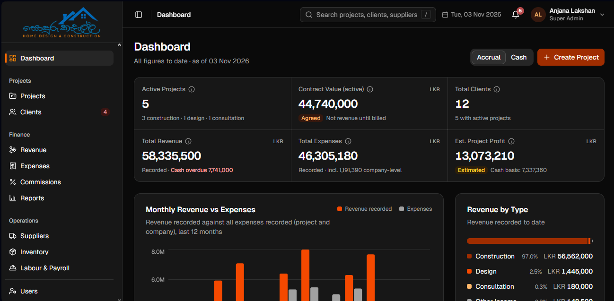
</p>

---

## Contents

- [Why this system?](#why)
- [Product tour](#product-tour)
- [Core capabilities](#core-capabilities)
- [How the money is counted](#how-the-money-is-counted)
- [Architecture](#architecture)
- [Technology stack](#technology-stack)
- [Repository structure](#repository-structure)
- [Roles and access](#roles-and-access)
- [Getting started](#getting-started)
- [Configuration and security](#configuration-and-security)
- [Database and migrations](#database-and-migrations)
- [Testing](#testing)
- [Important business rules](#important-business-rules)
- [Documentation](#documentation)
- [License](#license)

<a id="why"></a>

## 🎯 Why this system?

A construction company can be busy on every site and still not know which jobs are making money.
Payments come in installments and costs come from many places: cement from the store, sand
delivered to site, daily-wage workers, machine hire, referral commissions. A late handover can also
cost a delay deduction. Spreadsheets lose track of what belongs to which project.

This system answers the questions the owner asks every week:

1. **How much is each project worth, and how much of it has been billed and received?**
2. **What has each project really cost so far, and what is the profit?**
3. **Who owes us money, and whom do we owe: clients, suppliers, workers, commission agents?**

It is a project finance system, not a general ledger, tax or banking product.

<a id="product-tour"></a>

## 🖥️ Product tour

The screenshots show made-up development data for a year of work in the Anuradhapura area
(December 2025 to November 2026).

### 1. Dashboard

Active projects, the contract value still to be earned, clients, revenue, expenses and estimated
profit, all as of today. A toggle switches between **Accrual** (recognised when billed) and **Cash**
(when money actually moved). The (i) icon on each tile explains how its figure is worked out. Light
and dark themes are both supported.

<p align="center">
  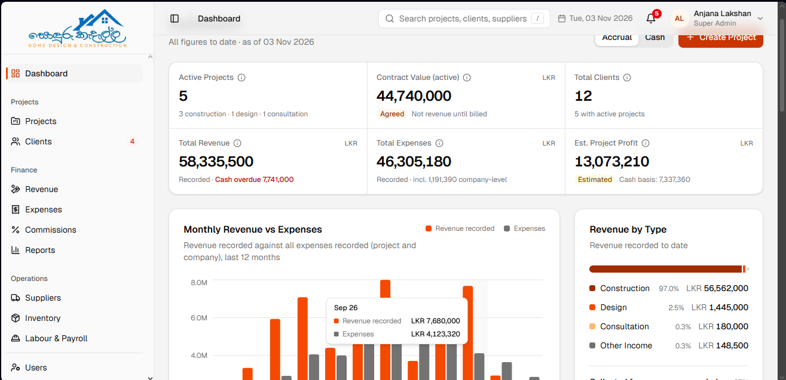
</p>

### 2. Projects

Every design, construction and consultation job with its contract value, money received, project
costs and outstanding balance. Overdue amounts are shown in red.

<p align="center">
  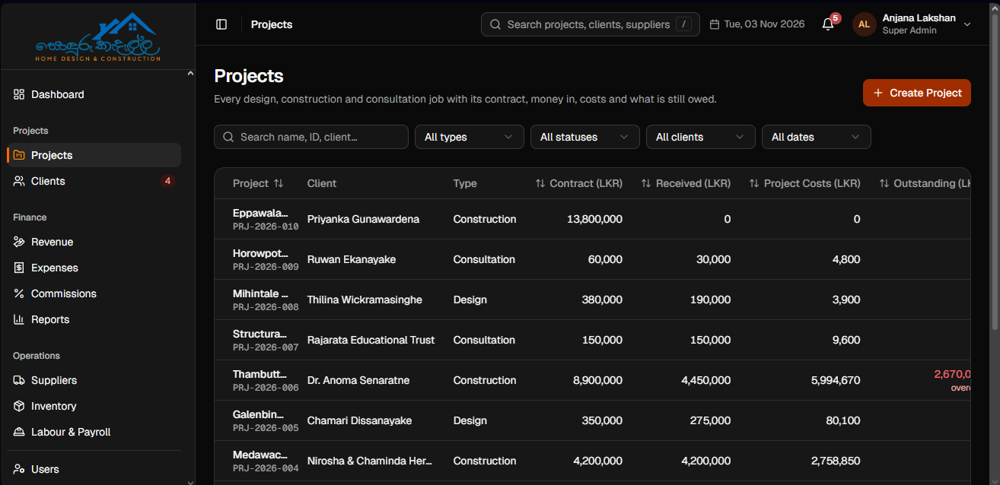
</p>

A new project gets its ID (`PRJ-YYYY-NNN`) automatically. It has a type, a client, the agreed
contract value and an installment schedule that must add up to it. For construction work, it also
holds the agreed delay-deduction terms.

<p align="center">
  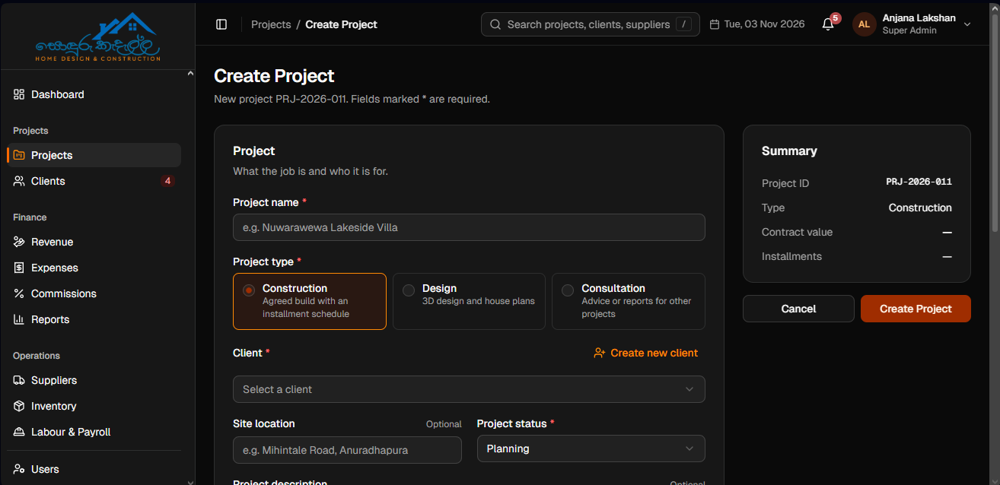
</p>

### 3. Revenue

Revenue is recognised when an installment is **billed**, never when a payment arrives. One
installment counts once, however many payments it takes. Scheduled installments that are not billed
yet are shown separately as expected income. Write-offs and delay deductions reduce the revenue
figure, and the caption shows both.

<p align="center">
  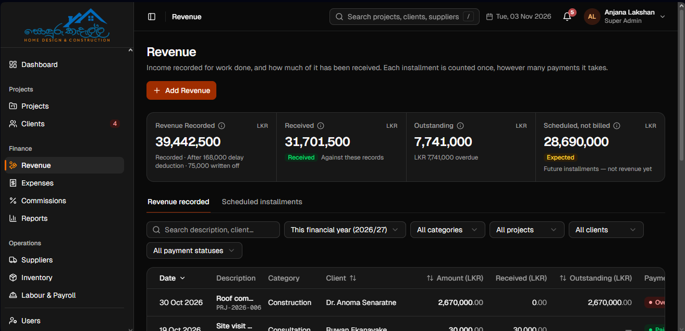
</p>

### 4. Expenses

Every expense belongs either to one project, so it counts in that project's profit, or to the
company (marketing, office and general costs). An expense and its payments are separate records, so
credit bills and part-payments are tracked until settled.

<p align="center">
  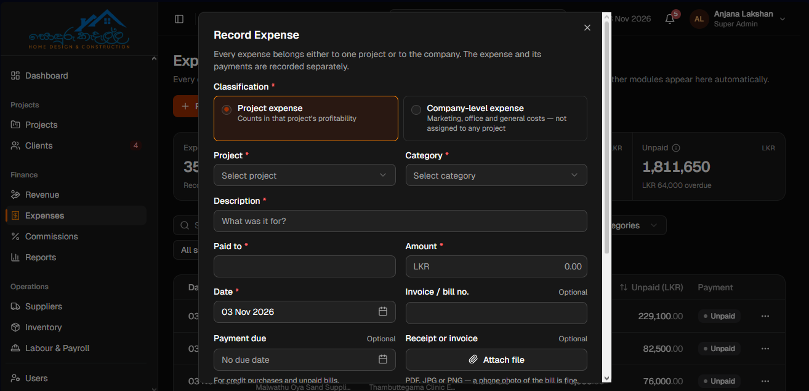
</p>

### 5. Suppliers

Supplier invoices are recorded either straight to a project or into stock. They stay unpaid until a
payment is recorded, and overdue bills are flagged.

<p align="center">
  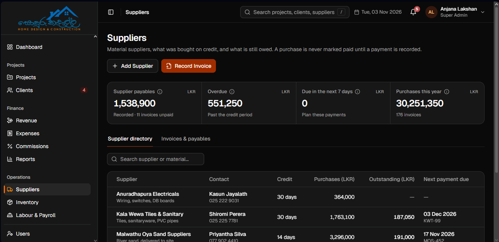
</p>

### 6. Inventory

Materials bought into the store are **not** a project cost. Issuing them to a site is: the cost is
taken first-in-first-out from the oldest stock. Returns, stock received and count adjustments are
recorded, with a note on what each one is for.

<p align="center">
  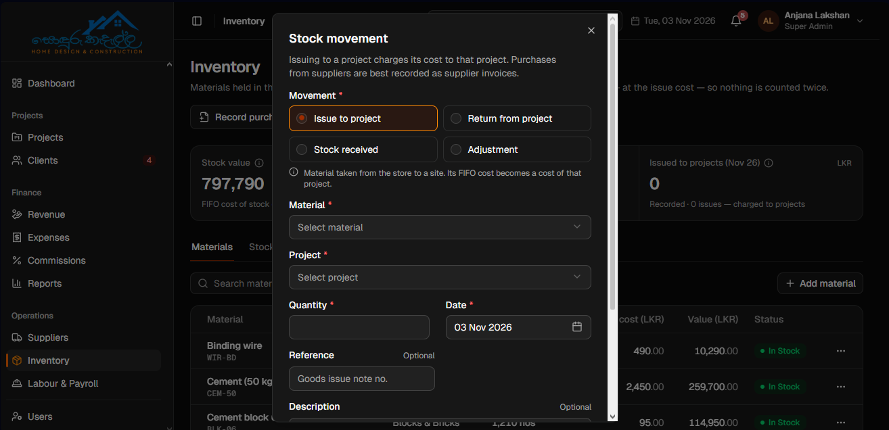
</p>

### 7. Labour & Payroll

The site supervisor marks each worker present, half day or absent, and which project they worked on.
Any day can be a work day, and the owner marks holidays one date at a time. Overtime needs approval.
Wages are paid weekly (Monday to Sunday), and salary advances are deducted from pay.

<p align="center">
  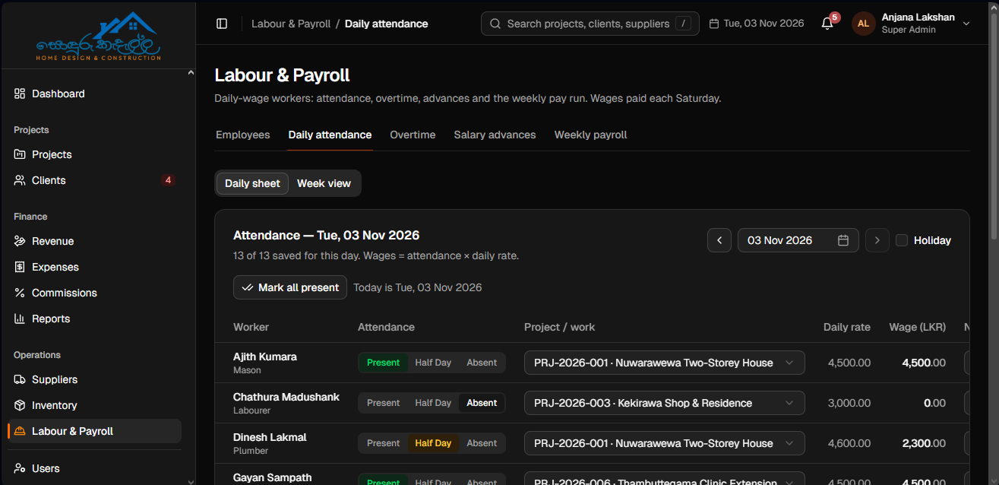
</p>

### 8. Reports

Income, expenses, project profitability, client receivables, supplier payables and labour payments,
each filterable by period and project, and exportable. They are built from the same records as
every other screen, so the figures always agree.

<p align="center">
  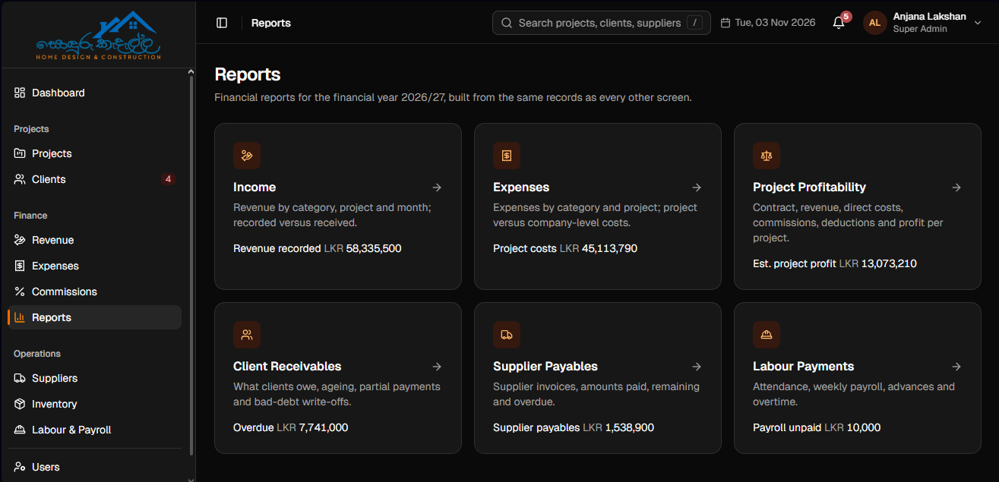
</p>

### 9. Settings

Company details, expense categories per project type, the commission policy, wage and overtime
settings, units of measurement, project statuses and payment methods.

<p align="center">
  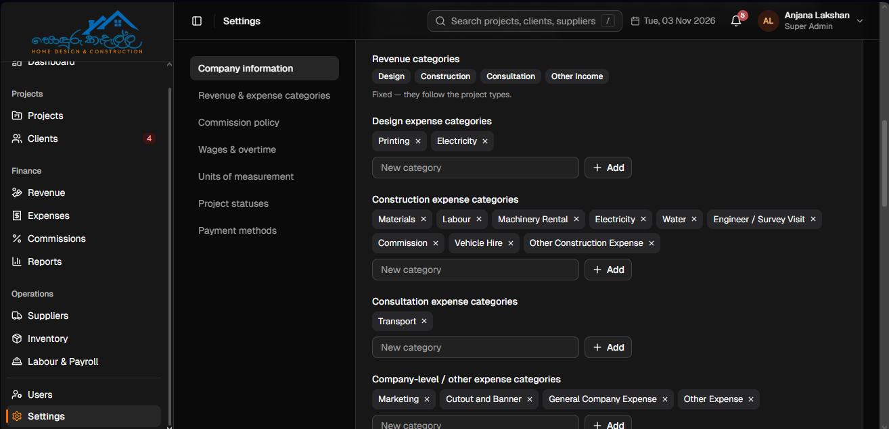
</p>

<a id="core-capabilities"></a>

## ✨ Core capabilities

### 📁 Projects and clients

- Clients (individuals or businesses) with their projects, history and what they owe.
- Three project types: **Design**, **Construction** and **Consultation**.
- Contract value, installment schedule, status (Planning, In Progress, On Hold, Completed, Cancelled).
- Signed agreement upload (PDF, stored privately and never served as a static file).
- Delay-deduction terms per construction contract: per day, a percentage per week, or a fixed amount,
  with grace days and a cap.

### 💵 Revenue and receivables

- Bill installments; record full or part payments against them.
- Write off bad debt with a reason; reverse a write-off if it was a mistake.
- Other income (scrap sales, equipment hire) with its own receipts.
- Overdue from the billing day; a planned date that passes unbilled is flagged as **billing late**.
- Notifications for overdue items and late billing.

### 🧾 Expenses, suppliers and stock

- Project and company-level expenses with categories, due dates and part-payments.
- Suppliers with credit days; invoices to a project or to stock, paid in one go or in parts.
- Materials with FIFO cost layers: receipts, issues, returns and adjustments.

### 👷 Labour and payroll

- Daily-wage workers with day and overtime rates; active or inactive.
- Daily attendance per project, holidays, overtime approval.
- Weekly payroll with advances deducted, other deductions and corrections. A paid week is frozen.

### 🤝 Commissions

- Referral agents, designers and draughtsmen paid a percentage of a project.
- A company commission policy. A design project's shares above the policy need the owner's decision.

### 📊 Reports and dashboard

- Accrual and cash views of revenue, costs and profit.
- Profit by period with a comparison to the previous period.
- Receivables by age; supplier payables due and overdue; labour by pay week.

<a id="how-the-money-is-counted"></a>

## 📐 How the money is counted

Every financial fact is stored **once**, so nothing is counted twice.

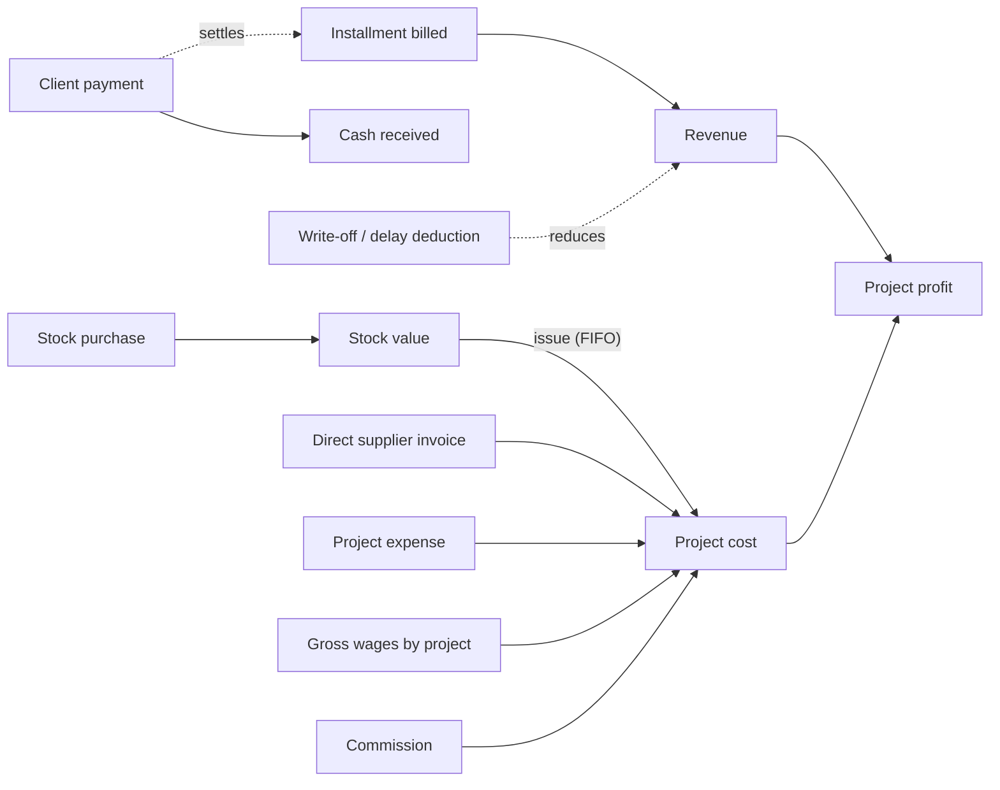

| Fact | Counted as | Not counted as |
| --- | --- | --- |
| Installment billed | Revenue | - |
| Client payment | Cash received against that one installment | Revenue |
| Stock purchase | Stock value | A project cost |
| Stock issued to a site | Project cost (FIFO) | - |
| Gross wages | Labour cost, split by project | - |
| Salary advance | Money already paid out, deducted from pay | A second labour cost |
| Delay deduction | A reduction of the billed installment | A change to the contract value |

All amounts use `BigDecimal` in Java and `NUMERIC` in PostgreSQL, with explicit scale and rounding.

<a id="architecture"></a>

## 🏗️ Architecture

A **modular monolith**: one Spring Boot application organised by business module, one PostgreSQL
database, and a React single-page application. There are no extra services, brokers or gateways.

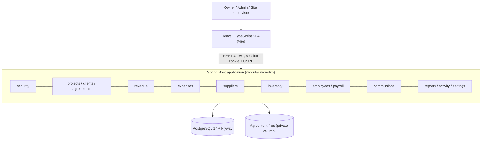

| Module | Responsibility |
| --- | --- |
| `security` | Sign-in, sessions, CSRF, CORS, sign-in throttling, users and roles. |
| `clients`, `projects`, `agreements` | Clients, projects, codes, statuses and signed agreements. |
| `revenue` | Installment schedules, billing, receipts, write-offs, delay deductions, other income. |
| `expenses` | Project and company expenses and their payments. |
| `suppliers` | Suppliers, invoices and supplier payments. |
| `inventory` | Materials, stock movements and FIFO cost layers. |
| `employees`, `payroll` | Workers, attendance, holidays, overtime, advances and weekly payroll. |
| `commissions` | Commission arrangements, the policy check and payments. |
| `reports`, `activity`, `settings` | Report data, the activity log and company settings. |

Module boundaries and API conventions are in [docs/ARCHITECTURE.md](docs/ARCHITECTURE.md).

<a id="technology-stack"></a>

## 🧰 Technology stack

| Area | Technologies |
| --- | --- |
| Frontend | React 18, TypeScript 5, Vite 5, React Router 6, Zustand |
| UI and styling | Tailwind CSS 4, shadcn/ui, Radix UI, Lucide icons |
| Charts and feedback | Recharts, Sonner |
| Frontend testing | Vitest |
| Backend | Java 25, Spring Boot 4.1, Spring Security, Spring Data JPA, Lombok |
| Database | PostgreSQL 17, Flyway migrations (`ddl-auto=validate`) |
| Build | Maven (wrapper), npm |
| Local environment | Docker Compose |

Check `backend/pom.xml` and `frontend/package.json` for the exact versions of a checkout.

<a id="repository-structure"></a>

## 📂 Repository structure

```text
SonduruKedella/
├── backend/                          # Spring Boot application (Maven)
│   └── src/main/
│       ├── java/com/sondurukedella/  # one package per business module
│       └── resources/db/migration/   # Flyway migrations (V1, V2, ...)
├── frontend/                         # React + TypeScript SPA (Vite)
│   ├── src/                          # pages, components, store, finance logic
│   └── scripts/                      # development data loader
├── docs/
│   ├── PROJECT_CONTEXT.md            # business requirements and scope
│   ├── ARCHITECTURE.md               # modules, API, authentication
│   ├── DATABASE.md                   # schema and money rules
│   ├── DEVELOPMENT_WORKFLOW.md       # setup, environment, sample data
│   ├── IMPLEMENTATION_STATUS.md      # what is built and verified
│   └── screenshots/
├── compose.yaml                      # PostgreSQL, backend and frontend for local use
├── Dockerfile.backend
├── Dockerfile.frontend
├── .env.example                      # variable names only (copy to .env)
├── LICENSE
└── README.md
```

<a id="roles-and-access"></a>

## 👥 Roles and access

Access is enforced by the backend. Hiding a button in the frontend is never the only check.

| Role | Can do |
| --- | --- |
| `SUPER_ADMIN` | Everything an Admin can, plus user administration (create, edit, change role, activate or deactivate, reset password) and changing the commission policy. |
| `ADMIN` | All business modules: settings, clients, projects, agreements, revenue, expenses, suppliers, inventory, labour, payroll, commissions and reports. |

The first Super Admin is created once, from environment variables, on the first start. See
[docs/DEVELOPMENT_WORKFLOW.md](docs/DEVELOPMENT_WORKFLOW.md), "First Super Admin".

<a id="getting-started"></a>

## 🚀 Getting started

### Prerequisites

| Requirement | Purpose |
| --- | --- |
| Docker Desktop with Docker Compose | PostgreSQL, backend and frontend containers |
| Java 25 JDK (optional) | Running or testing the backend outside Docker |
| Node.js and npm (optional) | Running the frontend or its tests outside Docker |
| Git | Source control |

If another project on your machine needs a different Java version, set `JAVA_HOME` for the current
terminal only.

### 1. Configure the environment

Copy `.env.example` to `.env` in the repository root and give every variable a development-only
value. `.env` is git-ignored. Never commit it, and never put secrets in `VITE_*` variables: those
are shipped to the browser.

### 2. Create the first Super Admin

Add `BOOTSTRAP_SUPER_ADMIN_USERNAME`, `BOOTSTRAP_SUPER_ADMIN_EMAIL` and
`BOOTSTRAP_SUPER_ADMIN_PASSWORD` to `.env` for the first start only, then remove the password.

### 3. Start everything

```powershell
docker compose config
docker compose up -d --build
```

| Service | Address |
| --- | --- |
| Frontend | `http://localhost:5173` (`FRONTEND_PORT`) |
| Backend API | `http://localhost:8080/api/v1` (`BACKEND_PORT`) |
| PostgreSQL | `localhost:5433` (`POSTGRES_HOST_PORT`) |

All ports bind to `127.0.0.1` only.

### 4. Development data (optional)

`frontend/scripts/seed-dev-data.ts` loads a year of made-up business through the real API, so every
business rule applies. It expects empty business tables and must never be pointed at production.
The steps are in [docs/DEVELOPMENT_WORKFLOW.md](docs/DEVELOPMENT_WORKFLOW.md), "Sample data".

<a id="configuration-and-security"></a>

## ⚙️ Configuration and security

- Credentials live in `.env` locally and in the environment in a deployment, never in code, docs or images.
- Sessions use an HTTP-only cookie with CSRF protection. CORS allows only the configured frontend origins.
- Failed sign-ins are throttled per username and per address.
- Passwords are hashed and never logged or echoed.
- `SESSION_COOKIE_SECURE` must be `true` in any deployment (HTTPS).
- Signed agreements are stored on a private volume and only downloaded through the authorised API.
- Sensitive actions (voids, reversals, corrections, status changes) keep a reason and an activity record.

The full list of security settings is in [docs/DEVELOPMENT_WORKFLOW.md](docs/DEVELOPMENT_WORKFLOW.md).

<a id="database-and-migrations"></a>

## 🗄️ Database and migrations

- PostgreSQL with Spring Data JPA. Hibernate never generates the schema (`ddl-auto=validate`).
- Every schema change is a new versioned Flyway migration in
  `backend/src/main/resources/db/migration`. An applied migration is never edited.
- Paid payroll weeks are frozen by database triggers. Later changes go in as corrections.
- Never reset the database or delete data without the owner's approval and a backup.

The schema and its rules are documented in [docs/DATABASE.md](docs/DATABASE.md).

<a id="testing"></a>

## 🧪 Testing

```powershell
# Backend: unit and integration tests against a real PostgreSQL
cd backend
.\mvnw verify
```

```powershell
# Frontend: type check, unit tests, production build
cd frontend
npm run typecheck
npm test
npm run build
```

The backend tests cover the business rules end to end, for example:
- billing, receipts and write-offs;
- FIFO costing;
- payroll freezing and advance recovery;
- commissions;
- delay deductions;
- authorisation.

The frontend tests cover the shared finance calculations, notifications and formatting. Passing
builds and tests do not replace a check in the running app.

<a id="important-business-rules"></a>

## 📌 Important business rules

- Revenue is recognised from **billed installments**, never from payments.
- A payment is counted once, against one obligation.
- A billed installment is overdue from its billing day until it is paid.
- Buying stock is not a project cost; issuing stock to a project is.
- Gross wages are the labour cost; advances are deducted from pay, not counted again.
- Delay deductions stay separate from retention and never change the contract value.
- A paid payroll week is frozen; later changes are corrections with a reason.
- Workers are deactivated, never deleted. Records are voided or reversed with a reason, not erased.

<a id="documentation"></a>

## 📚 Documentation

| Document | What it covers |
| --- | --- |
| [PROJECT_CONTEXT.md](docs/PROJECT_CONTEXT.md) | Business requirements, scope and confirmed rules |
| [ARCHITECTURE.md](docs/ARCHITECTURE.md) | Modules, API conventions, authentication and authorisation |
| [DATABASE.md](docs/DATABASE.md) | Tables, constraints, money rules and migration history |
| [DEVELOPMENT_WORKFLOW.md](docs/DEVELOPMENT_WORKFLOW.md) | Environment, first Super Admin, builds, sample data |
| [IMPLEMENTATION_STATUS.md](docs/IMPLEMENTATION_STATUS.md) | What has been built and how it was verified |

<a id="license"></a>

## 📄 License

This is proprietary, commercial software. The source code is visible in this repository, but no
licence is granted to use, copy, modify or distribute it. See [LICENSE](LICENSE).

---

<p align="center"><strong>Built for Sonduru Kedella, Anuradhapura: clearer numbers for every home we design and build.</strong></p>
